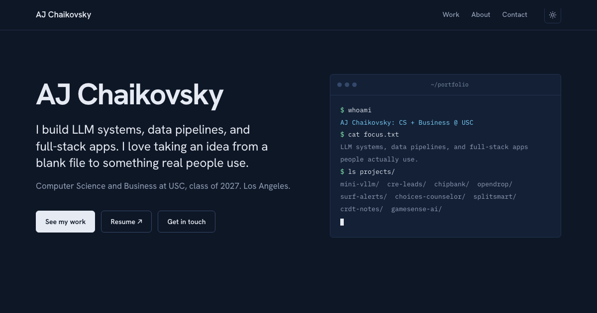

# AJ Chaikovsky — Portfolio

**Live site: [ajchaikovsky.com](https://ajchaikovsky.com)**

[](https://ajchaikovsky.com)

My personal portfolio: the projects I've built, a bit about me, and how to reach me.
It's a simple static site (plain HTML, CSS and JavaScript, no build step) hosted on GitHub Pages.

## Files

- `index.html`: page structure (hero, work, about, contact)
- `projects.js`: **your project list**. Edit this to add projects.
- `main.js`: builds the project panels and list, plus the count-up, theme toggle and copy-email button
- `styles.css`: all styling; colors and the type scale are variables at the top

## Customize

1. Name, email and links live in `index.html`; the about text is in the About section there.
2. Edit the projects in `projects.js`: adding a project is one new entry. Set `featured: true` on
   3–4 of them for the large panels, and give those 2–3 `metrics` (headline results). The rest go
   in the "More projects" list. Each needs a `status` ("Shipped", "In active use", or "In progress").
   The field list is at the top of the file.
3. Screenshots live in `images/`. Add `image: "images/name.png"` (and an `imageAlt` describing it) to any project.
   Put your resume at `anthony-chaikovsky-resume.pdf` and the "Resume" buttons appear automatically.
   `og-image.png` is the preview image shown when the link is shared; `favicon.svg` is the tab icon.
4. Colors are at the top of `styles.css`: dark is the default, and the `[data-theme="light"]`
   block is the light mode. `--signal` (sky blue) is kept for the headline results only.

The only animation is the headline numbers counting up when a panel scrolls into view. It's skipped
for visitors who have "reduce motion" turned on. There are no external scripts.

## Preview locally

Open `index.html` in your browser, or run:

```bash
python3 -m http.server
```

Then go to http://localhost:8000.

## Deploy (free)

- **GitHub Pages:** push this folder to a repo, then go to Settings → Pages → deploy from the `main` branch.
- **Netlify / Vercel:** drag and drop the folder, or connect the repo.
